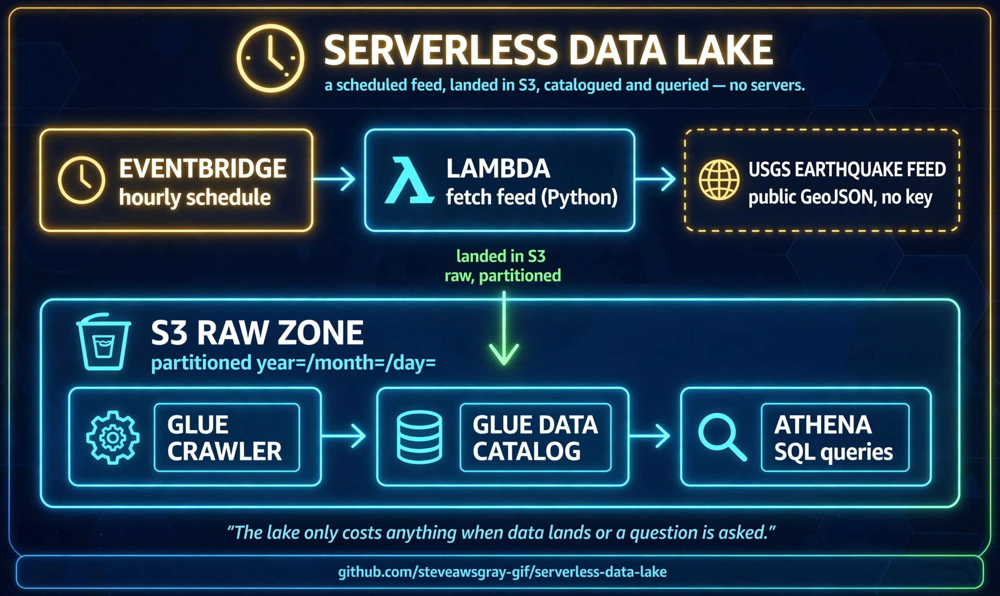

# Serverless Data Lake

A standalone serverless data lake on AWS — the "something cool with S3" build.

## What it does

Once an hour, a scheduled Lambda pulls a public feed and lands it in S3, partitioned by date. A Glue crawler catalogues the new files, and Athena queries them with plain SQL. No servers, no cluster — the lake only costs anything when data lands or a query runs.

## Architecture

```
EventBridge (hourly) → Lambda (fetch) → USGS earthquake feed
                                              ↓
                              S3 raw zone (year=/month=/day=)
                                              ↓
                     Glue crawler → Glue Data Catalog → Athena
```



Full design: `docs/design-brief.md`.

## The feed

USGS Earthquake Hazards Program, all-day feed — GeoJSON, updated every minute, free, no API key:

`https://earthquake.usgs.gov/earthquakes/feed/v1.0/summary/all_day.geojson`

Each run lands one file with every quake in the last 24 hours (time, place, magnitude, depth, coordinates). Swap the `FEED_URL` variable for any other JSON feed — the pipeline doesn't care what the feed is.

## Cost

Idle: effectively $0. S3 storage at this volume is a few cents a month; Lambda and Athena are pay-per-use; the Glue crawler is charged per run. Exact figures are confirmed before the apply, in the implementation session.

## Status

Design published Nov 25, 2026. AWS implementation later this week — plan and costs approved before any apply. **Nothing here has been applied yet.**

## Layout

- `terraform/` — the whole stack: S3, EventBridge schedule, Lambda, IAM, Glue database + crawler, Athena workgroup
- `lambda/` — the fetcher (Python, standard library + boto3)
- `docs/` — design brief + architecture diagram
